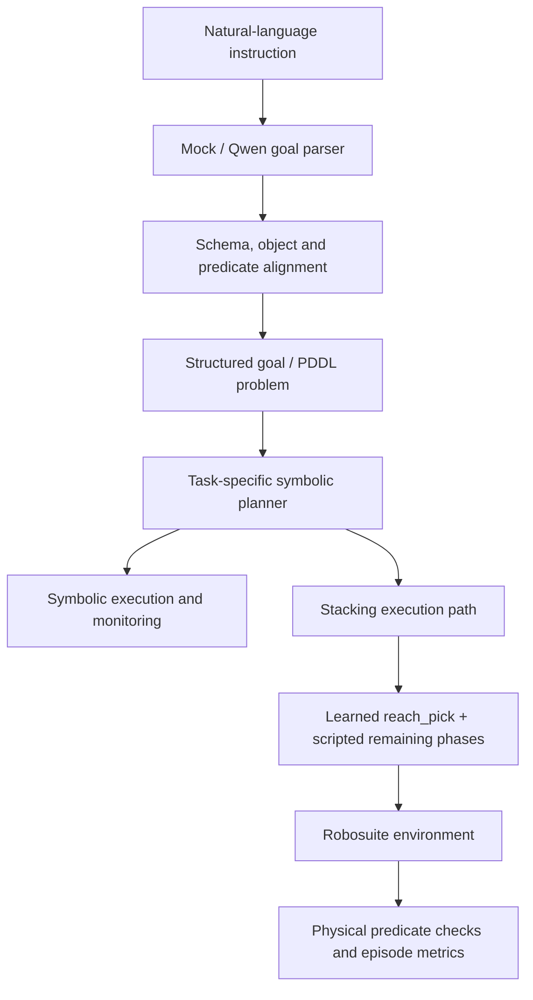

# VLM-NSM
### Language-aligned symbolic planning and hybrid robot skill execution

A research prototype that connects structured language goals, symbolic validation and planning, and robot skill execution. The public code includes Hanoi and block-stacking tasks, Qwen text-parser integrations, and a robosuite stacking pipeline with scripted and behavior-cloning controllers.

**Start here:** [Local setup](docs/local-development.md) · [Reproduction guide](docs/reproduction.md) · [Results and limitations](docs/results-and-limitations.md) · [Demo guide](docs/demo_guide.md)

> **Scope:** this README describes the code and reports in this repository. It does not claim to release the separate CALVIN / VLA-Adapter research workspace. Simulation results are not real-robot deployment results.

## What this project implements

| Component | Implementation | Boundary |
|---|---|---|
| Goal parsing | Mock parser, local Qwen2.5 text parser, optional online parser integrations | Mock, cached and live-model runs must be reported separately |
| Symbolic alignment | Schema checks, object/predicate whitelists, type checking, alias repair and goal-completeness checks | Task-specific symbols and repair rules |
| Planning | PDDL problem generation, internal Hanoi/stacking planners, optional Metric-FF adapter | Symbolic validity does not imply physical success |
| Skill execution | Phase-based stacking; scripted, replay and BC paths; opt-in skill-executor interface | Canonical learned control is limited to `reach_pick` |
| Evaluation | Language-variation experiments, alignment/prompt ablations, simulation reports and failure analysis | Historical tables have different settings; see limitations |

## Architecture



This is a modular planning-and-control prototype, not an end-to-end language-conditioned VLA policy. The canonical stacking path uses learned control for reaching and scripted control for the other phases. The [skill-interface design](docs/stage_19_skill_control_plan.md) documents a separate opt-in execution path.

## Get started without a GPU or model download

The supported lightweight profile uses **Windows + Python 3.10**. It excludes simulation, model execution and checks that depend on untracked experiment artifacts.

```powershell
git clone https://github.com/CodeGym712/VLM-NSM.git
cd VLM-NSM
py -3.10 -m venv .venv-minimal
.\.venv-minimal\Scripts\Activate.ps1
python -m pip install -e .
python scripts\run_local_tests.py -q
```

See [Windows local development](docs/local-development.md) for activation troubleshooting, optional dependencies and the exact test-profile boundaries. A fresh clone does not include every checkpoint or generated artifact required by historical experiments.

## Run a symbolic language-variation example

From an environment with the package installed:

```bash
python -m vlm_nsm.experiments.run_language_variation \
  --task hanoi --n_blocks 3 --parser mock --difficulty easy
```

The mock parser is a deterministic pipeline check; its results do not measure Qwen language understanding. See the [reproduction guide](docs/reproduction.md) before running local Qwen, API-based evaluation or simulation.

## Recorded simulation results

The following are **historical reported results**, not reruns performed for this documentation update. The [Stage 10 deployment table](generated/report_tables/stage_10/deployment_policy_comparison.md) reports:

| Policy | Evaluation size | Reported success |
|---|---:|---:|
| Scripted-only | 100 episodes | 88/100 |
| DAgger reach-only hybrid | 100 episodes | 92/100 |
| DAgger reach-only hybrid, three runs | 50 episodes per run | 96%, 90%, 94% |

These rows do not establish statistical significance, paired comparisons, an environment failure floor, or deterministic multi-seed reproducibility. The simulation documentation states that the seed flag is metadata and does not seed robosuite environment initialization.

The [Stage 10 E2E summary](generated/report_tables/stage_10/e2e_demo_summary.md) reports **5/5 mock-parser demos** using the same physical stacking outcome. This demonstrates pipeline integration, not general language understanding or five distinct manipulation skills.

Language-evaluation tables contain unresolved aggregation inconsistencies. No aggregate Qwen accuracy is promoted here. See [results and limitations](docs/results-and-limitations.md).

## Demo and artifacts

The repository includes [recording instructions](docs/demo_guide.md) and a [media manifest](assets/demo/v0_1_1/demo_media_manifest.md), but no committed MP4/PNG demo media was found in the tree reviewed for this update. Recording support is not a published video.

Simulation requires the configured robosuite/MuJoCo environment, checkpoint and execution config. Use the [artifact checklist](docs/reproduction.md#simulation-and-artifact-checklist) to identify missing inputs before launching a run.

## Repository navigation

| Path | Purpose |
|---|---|
| [src/vlm_nsm/core](src/vlm_nsm/core) | Goal parsing, alignment, PDDL and planning interfaces |
| [src/vlm_nsm/experiments](src/vlm_nsm/experiments) | Experiments, demos and report generation |
| [src/vlm_nsm/learning](src/vlm_nsm/learning) | BC training/evaluation utilities |
| [src/vlm_nsm/skills](src/vlm_nsm/skills) | Skill command and plan interfaces |
| [src/vlm_nsm/execution](src/vlm_nsm/execution) | Execution adapters |
| [data/language_variations](data/language_variations) | Easy/hard language-variation inputs |
| [tests](tests) | Tests; use the documented local profile |
| [generated/report_tables](generated/report_tables) | Committed historical report tables |
| [docs](docs) | Protocols, experiment reports and setup guides |

## Reading order

1. [Reproduction guide](docs/reproduction.md): choose a runnable tier and check prerequisites.
2. [Results and limitations](docs/results-and-limitations.md): understand what the reports support.
3. [Simulation protocol](docs/simulation_protocol.md): inspect controller phases and scoring.
4. [RGB grounding report](docs/stage_18_rgb_detector_pipeline.md): later perception work and comparison caveats.
5. [Skill-control plan](docs/stage_19_skill_control_plan.md): implemented interfaces versus next steps.

## Attribution and reuse

The earlier project description identifies this as an independent extension inspired by an NSM pipeline; it does not modify the original NSM repository. The code integrates third-party model, planning and simulation tools. Consult their individual terms for code, model weights and data. No root license file was present in the reviewed tree; this documentation update does not add or assume a repository-wide license.
